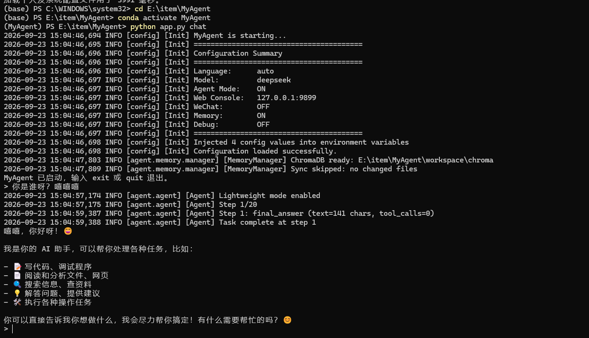
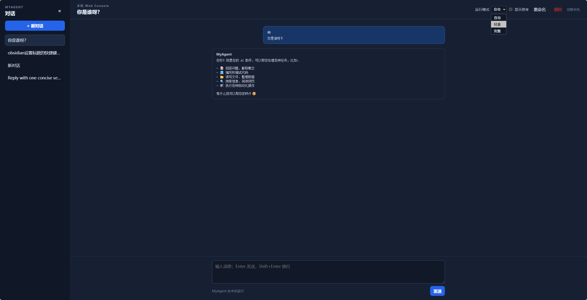

# MyAgent

MyAgent 是一个以 Python 手写 Agent Harness 的学习与实践项目。核心循环采用 ReAct 思路组织模型推理、工具执行与结果反馈，并围绕这一循环实现命令行聊天、本机 Web Console、记忆和 Skills 能力。

## 项目特点

- **Agent 核心**：通过 Thought → Action → Observation 循环处理多步任务，并限制最大执行步数。
- **工具调用**：提供文件读写与编辑、目录列表、Shell 命令、网页搜索与抓取、记忆管理等工具。
- **模型适配**：支持 OpenAI 兼容接口、Anthropic Claude 和 DeepSeek。
- **记忆与 Skills**：支持持久化记忆、记忆整理，以及按需加载 Skills。
- **混合记忆检索**：结合 SQLite FTS5 关键词检索与 ChromaDB 向量检索，支持可选的 BGE 模型重排和异常回退。
- **双交互入口**：交互式 CLI 与本机 Web Console；Web Console 提供会话管理和流式响应。

## 环境要求

- Python 3.13（项目当前开发和测试环境）。
- 可访问至少一个已配置模型服务的 API Key。
- 若启用默认的 Ollama 嵌入服务，还需要本机运行 Ollama，并准备配置中指定的嵌入模型；也可调整为已配置的 OpenAI 嵌入服务。

## 安装与配置

```bash
git clone https://github.com/yxl0808/MyAgent.git
cd MyAgent
python -m venv .venv
```

激活虚拟环境：

```bash
# Windows PowerShell
.venv\Scripts\Activate.ps1

# macOS / Linux
source .venv/bin/activate
```

安装依赖并创建本地配置：

```bash
python -m pip install --upgrade pip
pip install -r requirements.txt
```

```bash
# Windows PowerShell
Copy-Item config-template.json config.json

# macOS / Linux
cp config-template.json config.json
```

编辑 `config.json`，设置模型提供方和对应 API Key。例如使用 DeepSeek 时，将 `model` 设为 `deepseek`，并填写 `deepseek_api_key`。`config.json` 已加入 Git 忽略规则，请勿将包含真实密钥的配置文件提交到仓库。

## 使用

启动交互式聊天：

```bash
python main.py chat
```

启动本机 Web Console：

```bash
python main.py web
```

默认访问地址为 `http://127.0.0.1:9899`。Web Console 仅绑定 localhost 或回环地址，不提供公网监听。聊天中输入 `exit` 或 `quit` 退出。

## 运行效果

我为 MyAgent 实现了命令行聊天和本机 Web Console 两种交互入口。下图分别展示了 CLI 中基于 DeepSeek 的对话，以及 Web Console 的本机会话界面。

### 命令行



### Web Console



查看脱敏后的有效配置：

```bash
python main.py config
```

## 可选的本地记忆重排

默认使用关键词与向量结果的加权融合排序。如需启用 `BAAI/bge-reranker-v2-m3` 重排，先安装可选依赖：

```bash
python -m pip install -r requirements-reranker.txt
```

在现有 `config.json` 中添加或修改以下配置项，然后重启应用：

```json
{
  "memory_reranker_enabled": true,
  "memory_reranker_model": "BAAI/bge-reranker-v2-m3",
  "memory_reranker_device": "cpu",
  "memory_reranker_candidates": 20,
  "memory_reranker_batch_size": 4,
  "memory_reranker_max_length": 1024
}
```

启用后，每路召回至少 20 条候选，融合去重后选取前 20 条，使用查询和 SQLite 中的完整记忆块进行重排，再返回前 K 条。候选数由 `memory_reranker_candidates` 控制；若请求的 K 更大，则相应扩大候选池。模型输入最多截断为 1024 tokens，可通过 `memory_reranker_max_length` 调整。

模型在首次检索时加载；使用模型 ID 时，未缓存的权重会自动下载，之后复用模型。`memory_reranker_model` 也可设置为已下载的本地模型目录；具备兼容的 NVIDIA GPU 和 CUDA 版 PyTorch 时，可将 `memory_reranker_device` 设为 `cuda`。CPU 重排会增加检索耗时，可减少候选数量或关闭重排以降低延迟。

加载、推理或评分校验失败时，系统记录日志并回退到融合排序。加载失败后，修复依赖或模型路径并重启即可重试。重排分数仅用于排序，当前未设置相关性拒绝阈值。将 `memory_reranker_enabled` 设为 `false` 可恢复默认检索方式。

## 测试

```bash
python -m unittest discover -s tests -p "test_*.py" -v
```

## 项目范围

MyAgent 是单用户、本机运行的学习型 Agent 项目。本机 Web Console 通过 localhost 限制访问范围；如需远程使用，应先自行设计并部署适当的身份验证、网络隔离和传输保护。

## 许可证

当前仓库尚未声明开源许可证。若计划允许他人使用、修改或再分发，请先添加合适的 LICENSE 文件。
